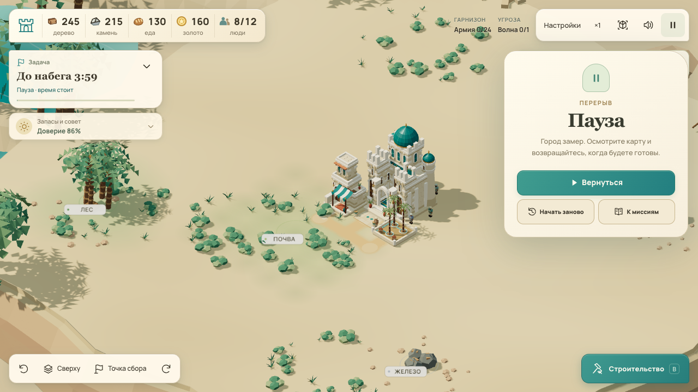
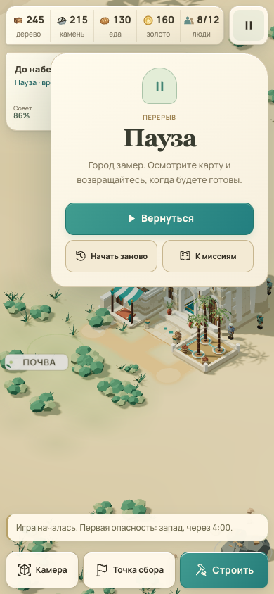

# Dunekeep — Fortress of the Sands

**[Play online](https://andreashxc.github.io/dunekeep-rts/)** — runs in your browser; no installation required.

A browser strategy game about building a desert settlement and keeping it alive through a six-mission campaign. Grow the economy, supply your garrison, connect walls and gates, and defend the keep.



*A real browser capture of the running game. The game interface currently uses Russian; this README is in English.*

## In the game

- Six campaign maps, with distinct terrain, resources, events and victory conditions.
- Three difficulty settings that affect resources, enemy strength and raid timing.
- Food and weapon production chains: farms, grain, mills, bakeries, mines and workshops.
- Settlement management with storage limits, housing, workers, taxes, rations and morale.
- Buildable walls, gates and towers; damaged buildings can be repaired or dismantled.
- A garrison of infantry, archers and mounted defenders, with siege units and wave combat.
- Planning mode and pause, camera rotation and zoom, graphics/audio settings, and touch controls.
- Procedural buildings, characters, landscape, UI artwork and Web Audio effects.

<details>
<summary>Mobile interface</summary>



The HUD adapts to portrait and landscape. Camera and construction controls remain available on touch devices.
</details>

## Run locally

Use **Node.js 22.12+** (verification used Node.js 24.10.0) and npm.

```bash
git clone https://github.com/andreashxc/dunekeep-rts.git
cd dunekeep-rts
npm ci
npm run dev
```

Validate and build:

```bash
npm test
npm run build
npm run preview
```

The servers bind to `127.0.0.1` by default. Vite produces a static `dist/` site with the project-specific Pages base path. An application backend or user account is not required.

## Getting started

Select a mission and difficulty, then start a new game. Preparation begins with time stopped: place resource and food buildings, then use the start button to begin the simulation and raid countdown. Opening a construction plan pauses the world while you place it.

The first mission introduces food production, a defensive tower and troop training. Later maps require a working economy and fortification layout; an undeveloped keep is not an automatic win.

| Action | Desktop control |
| --- | --- |
| Pan camera | WASD / arrows or left-button drag |
| Rotate camera | Q / E, right/middle drag, or Alt + drag |
| Zoom | Mouse wheel |
| Top-down view | T |
| Construction panel | B |
| Quick building | 1–9, then click a valid cell |
| Cancel placement | Right-click / Esc |
| Pause | Space / P |
| Reset camera | R |

## Implementation

TypeScript, Three.js, Vite and Vitest. `src/game/` contains the simulation and campaign rules; `src/render/` creates and updates the 3D scene; `src/ui/` handles the DOM interface; `src/audio/` produces the sound effects.

The 20 building portraits are rendered from the same procedural factories used on the map. During preparation, all 20 reproduced byte-for-byte with the tracked portrait renderer. The included Manrope font retains SIL OFL 1.1. No Stronghold assets or unused prototype model archives are included. See [asset provenance](docs/ASSET_LICENSES.md) and [third-party notices](THIRD_PARTY_NOTICES.md).

## Status and limits

This is an evolving playable prototype, not a finished commercial RTS. The production build and **559 tests across 45 test files** passed during preparation. Browser smoke checks covered campaign start, rendering, pause and desktop/mobile layouts, with no observed console errors, failed assets or external requests. The dependency audit reported no known vulnerabilities on 2026-10-12.

Those checks do not replace exhaustive campaign balancing, accessibility, device or performance testing. The Three.js production chunk exceeds Vite's 500 kB warning threshold. This public edition contains the reviewed main-line source; no other development-branch history is included. Historical design documents may describe ideas beyond the current implementation.

## Author and license

Created by **Andrew Manuilov** ([andreashxc](https://github.com/andreashxc)). This is the clean public edition of his original Dunekeep project.

Original project: [andreashxc/dunekeep-rts](https://github.com/andreashxc/dunekeep-rts).

Original work is licensed under [Apache-2.0](LICENSE). Retain the applicable attribution and [NOTICE](NOTICE) when distributing it. Third-party components retain their own licenses. See [AUTHORS](AUTHORS.md), [THIRD_PARTY_NOTICES](THIRD_PARTY_NOTICES.md) and [preparation changes](MODIFICATIONS.md).

## GitHub Pages

The Build, test and deploy workflow verifies the source, packages only dist/ and deploys it to GitHub Pages on pushes to main. Pull requests run checks without deployment. Static assets, fonts and image portraits use the project base path. No custom domain is configured by this project.
